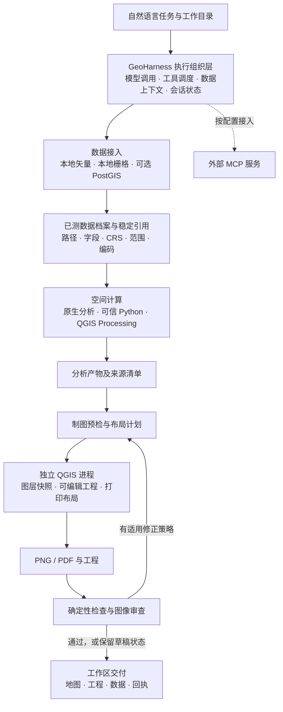

# GeoHarness

**面向空间分析与可验证制图的智能体执行框架**

GeoHarness 是基于 OpenHarness 构建的地理空间智能体系统。它将自然语言任务转化为数据检查、空间计算、地图编排、图像审查与成果交付过程，并为这些过程保留可追溯的输入、参数、脚本、工程和检查回执。系统以空间分析为基础，以地图表达为分析结果的呈现形式；语言模型负责组织任务和调用工具，具体几何运算、坐标转换与地图渲染由 GIS 软件执行。

系统当前主要面向区域尺度的矢量叠加、距离与影响范围分析，以及由这些结果驱动的多图层专题制图。默认静态制图路径复用本机 QGIS，通过独立 PyQGIS 进程创建可编辑工程，并从保存后的同一打印布局导出 PNG/PDF。系统同时保留自主 Python 分析和 Matplotlib/Folium 渲染入口，以支持结构化工具之外的可信分析任务。

**项目状态：研究与开发阶段，版本 0.1.0。** 本仓库提供系统实现与工程检查，不将工具执行成功、地图视觉通过或已有测试等同于空间分析结论正确。目前尚未提供标准化业务基准、制图质量准确率或自动修复收敛性评测。

## 目录

- [1. 问题定义与设计目标](#1-问题定义与设计目标)
- [2. 系统架构](#2-系统架构)
- [3. 数据契约与空间分析](#3-数据契约与空间分析)
- [4. 制图、审查与修正](#4-制图审查与修正)
- [5. 质量状态与证据边界](#5-质量状态与证据边界)
- [6. 可复现成果与工作空间](#6-可复现成果与工作空间)
- [7. 安装与最小运行](#7-安装与最小运行)
- [8. 典型任务与适用范围](#8-典型任务与适用范围)
- [9. 验证方式、局限与后续方向](#9-验证方式局限与后续方向)
- [10. 源码导航与许可证](#10-源码导航与许可证)

## 1. 问题定义与设计目标

空间分析任务要求同时处理数据语义、几何关系和地图表达。即使模型生成的脚本能够运行，结果仍可能受到坐标系误用、属性编码错误、时次选择不当、面积重复累加或地图要素遮挡等问题影响。因此，GeoHarness 将以下三类问题分别处理：

1. **输入与执行是否一致。** 实际读取的文件、字段、坐标参考系、筛选条件及输出路径是否与任务相符。
2. **分析表达是否可追溯。** 图上使用的图层、分类和统计说明是否来自对应的实际分析产物。
3. **最终地图是否可检查、可编辑。** 图片中的图例、标签、范围与布局是否经过检查，用户能否继续在 GIS 软件中修改成果。

围绕这些问题，系统采用五项设计原则：

| 设计原则 | 实现方式 |
|---|---|
| 分析先于表达 | 先明确研究对象、空间关系与计算口径，再组织符号、图例、主图和详图 |
| 数据驱动调用 | 工具返回实际路径、字段、CRS、范围及编码信息，后续调用复用已登记的数据引用 |
| 计算与编排分工 | 模型选择步骤和参数；GeoPandas/Shapely、Rasterio 及 QGIS 执行相应 GIS 操作 |
| 工程与图片同源 | QGIS 路径从保存后重新打开的工程布局导出图片，减少另行拼接造成的版面差异 |
| 分阶段报告质量 | 分开记录数据检查、渲染、布局、视觉审查、打包和交付，保留失败与未验证状态 |

这里的 **harness** 指模型周围的执行组织层：它管理工具、数据上下文、运行状态、产物和验证流程。GeoHarness 的工作重点是这一执行层与 GIS 能力的结合，而不是训练一个新的地理基础模型。

## 2. 系统架构

GeoHarness 在独立配置下组装 OpenHarness 的运行时、工具注册表、会话后端和查询引擎，不修改上游包源码。系统的逻辑结构如下。



上述结构按职责划分为四个部分：

| 部分 | 职责 | 主要实现 |
|---|---|---|
| 执行组织 | 加载配置、构造运行时、组织模型与工具交互、保存和恢复会话 | [`runtime.py`](src/geoharness/runtime.py)、[`engine.py`](src/geoharness/engine.py)、[`session_state.py`](src/geoharness/session_state.py) |
| 数据与计算 | 读取源信息、维护数据引用、执行空间运算与独立分析脚本 | [`data/`](src/geoharness/data/)、[`analysis/`](src/geoharness/analysis/)、[`execution/`](src/geoharness/execution/) |
| 地图工程 | 校验图层及分析来源、准备布局、运行 QGIS、保存工程和渲染结果 | [`cartography/`](src/geoharness/cartography/)、[`qgis/`](src/geoharness/qgis/) |
| 质量与交付 | 绑定地图版本与检查证据、审查实际图像、选择交付候选并核对复制结果 | [`jobs.py`](src/geoharness/cartography/jobs.py)、[`geo_map_review.py`](src/geoharness/tools/geo_map_review.py)、[`geo_deliver.py`](src/geoharness/tools/geo_deliver.py) |

### 2.1 工具组织

系统注册八个原生工具；启用 QGIS 后增加两个专用工具。此外保留五个上游辅助工具，用于提问、技能读取、任务记录和工具发现等交互。外部 MCP 工具在相应服务连接后动态注册，不计作默认内置分析能力。

| 工具 | 主要功能 | 范围说明 |
|---|---|---|
| `geo_vector_data` | 本地矢量数据发现、检查和加载 | SHP、GeoJSON、GPKG；CSV 需提供坐标列等必要信息 |
| `geo_raster_data` | 本地栅格检查与波段统计 | GeoTIFF、IMG、ASC、VRT；不等同于完整地形或栅格业务分析 |
| `geo_db_data` | PostGIS 表发现、属性与空间数据读取 | 需要配置数据库；仅使用本地文件时可不接入 |
| `geo_analysis` | 结构化矢量分析 | 缓冲、裁剪、相交、最近距离、分区计数、影响分析、面积统计 |
| `geo_python` | 执行可信的自主 Python 分析 | 保存脚本和日志；每次调用是新的执行进程 |
| `geo_cartography` | 分析结果与地图表达的统一入口 | 预检、符号化、制图、质量状态和工程处理 |
| `geo_map_review` | 审查实际地图图像并衔接适用修复 | 依赖可接收图像输入的模型服务 |
| `geo_deliver` | 将明确选择的成果复制到工作区交付目录 | 关联图片、工程、报告和质量回执 |
| `geo_qgis` | 发现和执行本机 QGIS Processing 算法 | 可选；先查询实际算法及参数，再执行 |
| `geo_qgis_project` | 原生工程预检、创建、读取和重导出 | 可选；使用真实 QGIS 工程与打印布局 |

QGIS 接入不意味着开放任意本机算法或命令。工具根据实际注册表返回算法信息，并应用执行策略与参数限制；修改源数据、远程连接、自由命令等不适用操作受到限制。具体可执行项以本机 `doctor/search/help` 的结果为准。

### 2.2 技能与外部扩展

系统包含空间分析、制图等任务技能，并保留 L1 感知、L2 理解、L3 推理的建议式提示机制。该机制用于提示模型考虑对象、空间模式和解释层次，不是必须逐级执行的算法流水线，也不构成统计结论的有效性证明。

Moran's I、LISA、Getis–Ord、聚类、OD 等扩展能力取决于所配置的外部服务或具体可执行算法。技能中出现这些方法的说明，并不表示对应工具已经连接或可以直接调用。

### 2.3 任务状态与失败恢复

模型请求、工具执行和工具结果分别管理。模型请求失败或返回不完整参数时，系统保留已经完成的工具结果，并按显式配置进行有限恢复，避免仅因模型重试而重复执行已有计算。工具参数无法通过校验时，调用被拒绝，不将其描述为已执行的分析。

会话状态保存待处理结果、数据档案与地图任务身份。每批回合耗尽后，可以依据新的成功进展及有限恢复条件自动进入下一批，沿用原任务；没有新的成功进展且恢复条件不再满足、末组工具重复失败、模型请求失败或用户取消时停止自动续跑。该机制用于延续长任务，不表示无条件重试或保证端到端完成。

## 3. 数据契约与空间分析

### 3.1 从数据名称到可定位的数据对象

文件名称不足以支持可靠调用。不同目录可以包含同名文件，同一分析也可能输出多个名为 `result` 的图层。GeoHarness 因此在数据发现、检查和加载时返回实际源信息，并将已测信息登记为后续调用的数据上下文。

这些信息按数据类型包括：

- **定位信息**：文件的实际路径、文件类型，或数据库表定位符；数据库源不伪造文件路径。
- **空间信息**：CRS、范围、几何类型和要素数量。
- **属性信息**：字段名称、类型，以及已测得的空值等描述。
- **读取信息**：可获得的字符编码、编码来源及未确认状态。
- **栅格信息**：宽高、波段、像元类型、分辨率、NoData、仿射变换等实际头信息。

无法测得的事实以 `unknown`、空值或明确的未确认状态保留，不由模型补写。完整读取结果与供模型重复使用的上下文摘要分别管理，后者受大小限制，不表示整个数据集已载入上下文。

后续工具可复用登记的 `data:` 引用或返回的实际完整路径。系统对文件状态变化、未知引用和重名歧义进行检查，以减少模型重新拼接路径、沿用过期档案或混淆分析产物的情况。

### 3.2 显式的空间关系与计量口径

结构化矢量分析由 `geo_analysis` 执行。输入分别声明被分析对象 `source`、参考对象 `reference` 及可选分区 `zones`，必要时通过实际属性筛选时次或情景。不同运算的空间含义保持区分：

| 分析问题 | 当前处理方式 | 解释时必须保留的区别 |
|---|---|---|
| 对象距参考要素多远 | 计算几何最近距离 | 几何距离不等于沿道路的出行距离或疏散时间 |
| 是否受到影响 | 按相交关系或明确距离阈值判定 | 位于范围内、与范围相交、位于外部距离带不是同一概念 |
| 分区内有多少对象 | 按相交关系逐区计数，包括边界相交 | 一个对象可计入多个相交分区，分区数量不能直接累加为去重总数 |
| 覆盖面积有多大 | 分别记录要素面积之和、合并去重覆盖及重叠差异 | 累计时次或重叠多边形的面积之和不等于总覆盖面积 |

度量运算要求有明确 CRS 的输入，并转换到以米为单位的投影坐标系。未配置 `analysis.metric_crs` 时，原生分析尝试估算局部 UTM；不适合自动选择的范围会要求显式配置。投影单位为米只是必要条件，具体投影是否适合研究区域与精度要求仍需判断，不能将 EPSG:3857 作为任意面积或距离分析的通用选择。

栅格与矢量也不要求共用一个原始 CRS。裁剪或掩膜前，应将几何转换到目标栅格的 CRS；给坐标重新贴上 CRS 标签不能代替坐标转换。系统不根据地名自动假定存在坐标偏移，也不对任意中国地区数据强制执行 GCJ-02 转换。

### 3.3 三种计算入口的分工

常规矢量任务优先使用结构化原生工具；本机已有的合适算法可以通过 QGIS Processing 复用；专门的数据准备或自定义计算可使用 Python。三者共享产物管理思路，但其证明范围并不相同。

`geo_analysis` 会持久化图层、表格和来源清单。地图引用这些结果时，系统核对实际输出、摘要、数量以及对应的制图图层；部分统计还会从持久化结果重新计算并比对。原生清单不能任意绑定到无关图层或被 Python 改写后却未声明来源关系的文件。

这类核对证明的是结果文件与地图说明之间的对应关系，不是对原始观测、研究假设或完整分析方法的独立验证。QGIS Processing 和自由 Python 的成功结果，也不会仅因存在日志或清单就自动获得相同的原生分析事实认证。

## 4. 制图、审查与修正

### 4.1 先预检，再消费布局计划

静态地图默认走 QGIS 路径。新建或修改地图时，先以实际图层、符号、字段、标签和主详图范围执行 `preflight`。预检检查数据与样式约束，并在启用原生布局测量时检查图例、说明栏、名单表和地图框等内容。

带布局的预检成功后会返回短引用 `plan_ref` 及可直接使用的创建调用；不带布局的简短预检可直接返回检查报告。收到 `plan_ref` 时，创建阶段使用已检查的参数，不要求模型再次生成整组图层和布局；若需修改内容，应重新预检。该机制减少长参数重发和两次调用之间的布局漂移，但不保证模型的第一次输入总是正确。

主图与详图可以分别指定关注对象、绘制图层和标注图层，编号可与可编辑名单表对应。布局适配基于实际纸面尺寸和测量结果进行，必要时调整图框或页面。保留必要对象覆盖是约束之一，不能为满足放大要求而静默删去主体。

### 4.2 工程与图片的一致性

QGIS 在独立解释器中运行，主 Agent 不加载其 Qt、PyQGIS 或原生库。主进程与工作进程通过 JSON 和本地文件交换请求与结果，不跨进程传递 QGIS 内存对象。

新建工程使用 GPKG、GeoTIFF 等本地数据快照，保存真实 `.qgs/.qgz` 工程及打印布局，再重新打开保存后的工程导出预览和可选 PDF。用户在 QGIS 中修改工程并保存后，可以使用 `geo_qgis_project` 的 `export` 操作导出新版本；原工程不会被该重导出操作覆盖。

需要区分两类工程：

| `project_fidelity` | 含义 | 使用方式 |
|---|---|---|
| `saved_layout` | 图片由保存后的 QGIS 布局导出 | 适用于图片与可编辑布局同源的默认 QGIS 路径 |
| `reference` | 为已有原生渲染图片补充的参考 QGIS 工程 | 保留兼容入口；不能据此声称 QGIS 布局与原图完全相同 |

工程可编辑并不意味着任意计算机、字体环境和 QGIS 版本都能产生逐像素相同的输出。共享工程时应携带整个工程目录及其数据依赖，并记录必要的运行环境。

### 4.3 基于实际图像的反馈

`geo_map_review` 读取生成图片，并结合已登记的工程与布局证据组织审查。视觉检查依赖支持图像输入的模型/API，可与主任务使用不同配置。服务故障、无效返回、禁用或缺少有效证据时保持未验证状态；像素非空、颜色检出或文件存在不能替代视觉审查。

当问题具有适用的呈现修复策略时，系统可调整布局或符号参数，重新渲染并检查新图。修复应保持分析对象、筛选口径和统计含义；模型不能仅为改善视觉效果而改写分析结论。复杂问题也可能需要主 Agent 重新组织主详图或交由用户编辑。

当前不按地图版本数量或累计审查时长设置总额度上限，但单次脚本/API 超时、模型输出长度、输入图像大小、失败缓存与服务冷却仍然有效。检查通过、无适用策略、没有有效进展、具体执行失败或用户取消，都可以使流程停止。系统不承诺任意任务都能自动修复到通过。

## 5. 质量状态与证据边界

GeoHarness 为地图维护持续的任务身份与版本记录。修改文件名不等于创建了独立的质量证明；检查必须与对应版本的实际文件绑定。当前阶段回执如下。

| 阶段 | 记录内容 | 不据此推断的结论 |
|---|---|---|
| `parameters` | 地图任务与调用参数 | 参数已经具有科学合理性 |
| `data_checked` | 字段、CRS、几何、范围、数量及相关来源检查 | 原始数据真实、完整，分析方法正确 |
| `rendered` | 当前地图文件已生成并登记 | 图层表达和视觉质量正确 |
| `layout_checked` | 报告所覆盖的分区、边界、图例与文字布局测量 | 所有标签都无碰撞、无遗漏 |
| `visual_checked` | 与当前图片绑定的实际视觉审查 | 数值、因果关系或研究结论正确 |
| `packaged` | 工程、预览和依赖文件的打包核对 | 视觉审查已经通过 |
| `delivered` | 成果已复制并生成交付回执 | 所有其他阶段都已通过 |

只有 `data_checked`、`rendered`、`layout_checked` 和 `visual_checked` 四项均为 `passed`，地图的 `quality_status` 才为 `passed`；否则为 `draft`。打包和交付另行记录，质量通过并不表示已经完成交付。

该状态的范围明确限定为 `map_data_contract`、`layout_geometry` 和 `visual_image`。**`analysis_correctness` 当前始终为 `unverified`。** 因此，`passed` 应理解为当前地图在这些检查范围内通过，而不是整项地理研究或分析结论已获验证。

图片、工程或相关产物变化后，系统会核对对应摘要，将受影响证据标为 `stale`。历史报告不能直接认证新文件。交付默认优先选择同一地图任务中未变化且具有有效检查的候选版本，并同时选择它对应的工程。候选需要有效的渲染与布局测量记录，包含工程时还需打包检查通过；满足候选条件但没有完整视觉证据的成果，仍可作为明确标注的草稿交付。

## 6. 可复现成果与工作空间

系统将内部执行产物与用户交付成果分开保存。下面是默认配置下的目录职责示意，不表示每个任务都会生成全部目录或文件。

```text
工作目录/
├── 数据/                         # 用户输入；不要求固定使用此目录名
├── .geoharness/
│   ├── analysis/                 # 原生分析图层、表格与 manifest
│   ├── runs/                     # Python 脚本、日志与输出
│   ├── qgis/                     # 独立 QGIS 请求、结果与工程
│   ├── qgis-plans/               # 预检计划
│   ├── maps/                     # 持久地图任务与质量记录
│   └── tasks/                    # 内部任务记录
└── exports/                      # 用户可取得的交付成果
    └── 交付目录/
        ├── 地图与其他选定文件
        ├── project/              # 如交付了可编辑工程，需整体保留
        ├── delivery.json
        ├── map-receipt.json
        ├── summary.json
        └── summary.md
```

每次 Python 执行保留脚本、标准输出、错误输出和产物清单；每次 QGIS 工作保留请求、结果和运行记录。后续调用应使用工具实际返回的路径，不根据时间戳猜测运行目录。

这些记录为复查和重放提供基础，但文件齐全并不自动构成完全可复现性。研究使用时还应记录仓库提交、依赖版本、模型/API 配置、数据版本、投影选择与关键参数；模型服务变化、字体环境和外部依赖都可能影响重跑结果。

## 7. 安装与最小运行

### 7.1 运行条件

| 组件 | 是否必需 | 说明 |
|---|---|---|
| Python 3.10+ | 必需 | 建议在独立 Python 环境中安装 |
| 可用的模型 API | 执行智能体任务时必需 | 采用 OpenAI 兼容接口，并需支持实际使用的工具调用方式 |
| 图像输入能力 | 视觉审查时必需 | 可由单独配置的审查模型提供，不能仅凭模型名称假定可用 |
| 本机 QGIS 与 PyQGIS 环境 | 默认 QGIS 制图路径必需 | 独立安装；无需打开 QGIS 桌面，不能仅靠普通 pip 安装 PyQGIS 替代运行时 |
| PostgreSQL/PostGIS | 可选 | 仅数据库数据源需要，本地文件流程不要求数据库 |
| 外部 MCP 服务 | 可选 | 按实际安装入口配置；未连接时不提供相应扩展工具 |

QGIS 不可用时，已有本地数据和 Python 工具仍可使用；需要旧静态渲染时可显式设置 `qgis.enabled: false` 与 `cartography.static_renderer: matplotlib`。这条路径不会自动获得 QGIS 布局同源导出的保证。

### 7.2 安装

在选定并激活的 Python 环境中运行：

```bash
git clone https://github.com/kevics1/GeoHarness.git
cd GeoHarness
python -m pip install .
geoh version
geoh init
```

安装过程会拉取 `pyproject.toml` 声明的 Python 依赖，包括 `openharness-ai>=0.1.9,<0.2`、GeoPandas、Rasterio 和相关组件。QGIS 运行时单独安装。wheel 会包含项目内置技能；安装环境的 Scripts/bin 在 PATH 中时，可以从任意工作目录运行 `geoh`。

### 7.3 配置

`geoh init` 在 `~/.geoharness/` 创建配置文件、`.env` 和工作空间目录。它与 `~/.openharness/` 分开管理。已有配置默认保留，只有明确指定 `--force` 时覆盖。

在该配置目录的 `.env` 中填入实际服务信息。以下均为占位值，必须替换：

```dotenv
GEOH_MODEL=replace-with-your-model-id
GEOH_API_KEY=replace-with-your-api-key
GEOH_BASE_URL=https://your-service.example/v1
```

编辑同目录的 `config.yaml`。下面的最小示例使用本地数据、QGIS 静态渲染和工作目录交付；模型服务须另外实际验证可用。

```yaml
model: ${GEOH_MODEL}
api_key: ${GEOH_API_KEY}
base_url: ${GEOH_BASE_URL}
mcp: {}

data:
  file_dir: .
analysis:
  metric_crs: ""             # 空值尝试局部 UTM；不适用时显式选择合适投影
cartography:
  static_renderer: qgis
qgis:
  enabled: true
delivery:
  outputs_dir: exports
map_review:
  enabled: true
```

审查服务默认复用主模型配置。若主模型不支持图像输入，可单独设置 `map_review.model`、`map_review.base_url` 和 `map_review.api_key`，敏感值仍通过环境变量引用。仓库的 [`config.example.yaml`](config.example.yaml) 另外保留本地聚合服务的配置示例，其中的地址和模型别名不是通用运行条件。

### 7.4 自检与启动

```bash
geoh dry-run
geoh qgis-doctor
geoh run
```

`dry-run` 验证运行时组装，不发送一次完整模型任务，也不证明 MCP 已连接或 QGIS 可以执行。`qgis-doctor` 才会实际检查独立 QGIS 环境与提供者。两者均不能代替真实模型/API 调用或业务验证。

常用入口：

```bash
# 从当前目录启动；默认使用 TUI
geoh run

# 指定工作目录，替换为自己的数据路径
geoh run --cwd "/path/to/workspace"

# 打印模式，跳过 React TUI
geoh run --print

# 指定配置文件
geoh run --config "/path/to/config.yaml"
```

详细的 QGIS 定位、MCP 部署、工程编辑与重导出见 [`user-guide.md`](user-guide.md)。不要将个人 `.env`、数据库连接信息或模型密钥加入公开仓库。

## 8. 典型任务与适用范围

以区域灾害影响分析为例，输入可以包含事件点、当前与预测影响范围、居民点、避难场所、道路和高程栅格。下面是一种任务组织方式，**不是本仓库已完成的基准实验或效果承诺**：

1. 检查各图层的实际路径、字段、编码、CRS 和范围，确认预测数据的时次与情景。
2. 明确参考范围，计算相交对象、外部距离带和分组覆盖面积，保留对应口径与清单。
3. 以分析输出构建地图图层，区分区域态势与局部细节，必要时使用编号名单表。
4. 执行预检，消费已检查计划生成工程和图片。
5. 检查实际地图，修正有证据支持的呈现问题；服务不可用或仍有问题时保留草稿状态。
6. 将地图、可编辑工程、选定分析产物和回执交付到工作目录。

可在准备好的工作目录中提出类似请求：

> 根据当前目录的数据制作区域影响分析专题图。先核对数据源、坐标系、字段与预测时次，再计算居民点和影响范围的关系；分别表达区域态势与局部细节，审查实际地图，并交付图片、可编辑 QGIS 工程和质量回执。未验证的部分请明确说明。

该流程也适用于设施邻近分析、服务范围叠加和其他区域专题表达。它不自动提供道路网络疏散规划、灾害传播预测或因果推断模型；输入预测范围可以用于分析和制图，并不表示系统重新完成了预测过程。

## 9. 验证方式、局限与后续方向

### 9.1 验证层次

仓库的 [`tests/`](tests/) 包含数据读取与引用、分析语义、QGIS 调用与工程、布局、审图绑定、交付一致性以及模型流恢复等测试。应区分以下证据：

| 验证层次 | 能回答的问题 |
|---|---|
| 单元与契约测试 | 给定输入和受控依赖时，接口、状态或计算分支是否符合预期 |
| 本机 GIS 集成检查 | 实际安装的依赖能否执行、持久化并读回相应成果 |
| 模型服务检查 | 当前 API 是否支持所需文本、工具调用和图像输入 |
| 业务与人工核验 | 对具体数据和方法，地图语义与分析结论是否符合任务及领域要求 |

本地测试或小型集成检查不能替代最后一层，也不能推导出端到端成功率。诊断记录反映特定输入、版本和环境，不作为跨环境的性能基准。

如需参与开发，可安装开发依赖并选择相应检查：

```bash
python -m pip install -e ".[dev]"
python -m ruff check src tests
python -m pytest
```

完整测试可能包含依赖本机环境的检查；具体前置条件以测试定义为准。仅修改文档时，不需要据此重新运行完整业务地图流程。

### 9.2 当前局限

- **空间语义仍需领域判断。** 时次选择、距离阈值、投影适用性和输入数据质量不能由工具成功状态替代。
- **视觉审查具有模型依赖。** 服务可能不可用，也可能漏检或误判；复杂标签、图例与多图框修复仍存在异常和适用性边界。
- **布局测量不是全图语义证明。** 模板中的边界检查不保证所有标签显示，也不证明地图叙事与分析结论正确。
- **执行保护不是操作系统沙箱。** 路径、输出、网络与子进程限制用于可信 GIS 工作流；自由 Python 和本机原生组件不应被当作可安全执行任意不可信代码的环境。
- **软件与服务环境会影响结果。** QGIS/GDAL/PROJ、字体、模型响应和外部数据变化都会影响复现；主要开发与集成验证集中在 Windows，其他平台应单独核验。
- **扩展能力与业务验收不等同。** 本地栅格读取和 QGIS 算法入口不表示所有地形、热点和复杂空间模型已完成业务验收。当前不提供在线天地图瓦片下载工具。

后续工作重点包括代表性业务基准、标签与遮挡的确定性测量、修复前后比较、复杂工程编辑保真，以及对准确率、失败类型、执行开销和人工介入次数的系统评估。这些是待验证方向，不作为当前版本的已完成结果。

## 10. 源码导航与许可证

```text
src/geoharness/
├── config/          # 配置模型与加载
├── data/            # 数据源、元数据、编码和上下文引用
├── analysis/        # 原生矢量分析
├── execution/       # 可追溯 Python 执行
├── qgis/            # 独立 QGIS 运行时、Processing 和工程处理
├── cartography/     # 制图预检、分析来源、渲染、审查与任务回执
├── tools/           # 模型可调用接口
├── hooks/           # 建议式认知提示
├── mcp/             # 可选外部工具连接
├── runtime.py       # 运行时组装
├── engine.py        # 任务执行与恢复
└── cli.py           # 命令行入口
```

- 操作手册：[`user-guide.md`](user-guide.md)
- 执行架构细节：[`architecture.md`](architecture.md)
- 配置示例：[`config.example.yaml`](config.example.yaml)
- 依赖与构建定义：[`pyproject.toml`](pyproject.toml)
- 测试：[`tests/`](tests/)
- 历史诊断与限定条件：[`diagnostics/`](diagnostics/)

GeoHarness 依赖 OpenHarness、QGIS、GeoPandas、Shapely、Rasterio、Matplotlib、Folium 等软件组件；各组件遵循其自身许可证。GeoHarness 的项目代码按 [MIT License](LICENSE) 发布。

用于研究或复现实验时，请注明 [GeoHarness 仓库](https://github.com/kevics1/GeoHarness)及实际使用的提交版本，并另行记录数据、环境和模型服务配置。当前 README 是软件系统说明，不作为已发表论文或经过独立验证的实验报告。
