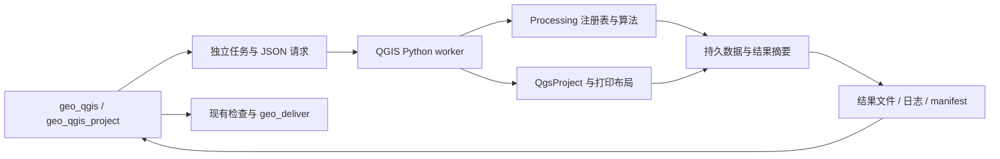

# GeoHarness 执行架构

主 Agent 运行在安装 GeoHarness 的 Python 环境中。现有 GeoPandas、matplotlib 与
可信 Python 分析执行入口保留；QGIS 通过独立安装的 Python 解释器运行，不向主进程
导入 PyQGIS、Qt 或它们的 native 库。没有 QGIS 时可以禁用集成，其他工具仍可运行。

## QGIS 数据流

`qgis/discovery.py` 按配置或安装记录定位运行时，构造只包含系统必需变量和 QGIS
路径的子进程环境。`qgis/runner.py` 为每个调用创建唯一目录，持久化请求，启动
原生 Python 并等待结果。stdout/stderr 与 JSON 响应分开保存，native 日志不会破坏
协议。每个任务独立初始化 QGIS；当前没有跨任务的常驻进程或内存图层共享。

`qgis/worker.py` 只在子进程初始化 QgsApplication、字体与提供者，分派到
processing_worker 或 project_worker。主进程与 worker 交换文件路径和 JSON，
QGIS/Qt 对象不会跨进程传递。QGIS 模块的 API 依赖来自独立安装，不是 pip 依赖。

## Processing 执行

算法目录来自本机 registry，查询结果包含实际 ID、提供者和执行限制。help 返回
真实参数定义、默认值、枚举及输出定义；run 据此准备输入输出并校验参数，再调用
Processing。结果层必须持久化后才返回，摘要记录字段、数量、CRS 和范围。

本地 .model3 可复用多个已批准的内置算法；逐个检查模型子算法及参数来源。
脚本/表达式生成的文件路径、自定义提供者、数据库连接或自由命令参数不属于当前
支持范围。原有分析接口的距离和计数语义不因 QGIS 集成而改变；通用 Processing
调用按具体算法语义执行，使用者必须指定合适的分析 CRS 和单位。

## 工程与交付

新 QGIS 路径通过 PyQGIS 创建、读取、保存真实工程，使用 QGIS 自己的布局导出器
生成预览和 PDF。保存图层 ID 与样式，将源数据复制为本地 GPKG/TIFF，并将外部
图片/符号资源复制进包。重新导出用户工程时写入新目录，保留输入工程。

`project.json` 的 backend=qgis、project_file、preview、preview_sha256 和 files
供 geo_deliver 打包；原有 matplotlib 工程格式继续兼容。交付验证预览摘要并复制
明确列出的包文件。导出成功不代表数据或地图审查通过，继续使用现有视觉审查与
draft/passed 状态。本轮不实现前期讨论的质量裁决、修改比较与评测框架。

## 隔离与取消

输入只从工作区、配置的数据目录和产物目录读取；输出只能写入本次唯一任务目录。
配置、凭证、远程 URI 和源文件覆盖均受接口约束。VRT 等支持格式的依赖也检查路径。
子进程不继承主 Agent 凭证和个人 QGIS 配置，使用独立 profile。

Windows worker 启动 native 代码前附加 Job Object；取消/超时清理整个任务进程树。
其他平台使用独立进程组。这里的路径与算法检查用于可信 GIS 工作流，不是可抵御
任意恶意 native 代码的操作系统沙箱。
