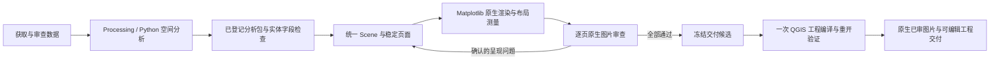

# GeoHarness 执行架构

主 Agent 运行在安装 GeoHarness 的 Python 环境中。现有 GeoPandas、matplotlib 与
可信 Python 分析执行入口保留；QGIS 通过独立安装的 Python 解释器运行，不向主进程
导入 PyQGIS、Qt 或它们的 native 库。没有 QGIS 时可以禁用集成，其他工具仍可运行。

## 当前阶段与数据流

QGIS Processing 和分析控制台仅做空间分析。模型主制图接口为 `GeoNativeMapTool`：
Pydantic Scene 保存真实图层、单位、分类、稳定页 ID 和分析引用；Matplotlib Agg
渲染 PNG/PDF，可额外导出 SVG/Folium HTML。制图和审图阶段不启动 QGIS。
旧 QGIS 制图工具留在兼容实现中，模型 registry 仅注册其只读 inspect 接口。

`scene_render.py` 冻结字体、来源哈希、选集、图框、文字落位和逐页 PNG 身份。
按页内容身份缓存 PNG 与矢量 PDF；名册改动不重绘无关地图页。台账仅对同一页面
内容身份与哈希保留既有审查，生成工程不增添地图版本。原生布局测量覆盖已测文字、
点符号框、标注引线和显式对象覆盖约束，不宣称检查所有复杂符号形状或业务语义。

`review_schedule.py` 将已登记地图的验收要求持久绑定到真实 `page_id`。
`all_pages` 先核对清单完整性，只对没有有效证据的页面发送图片请求；复用必须同时匹配
图片、报告 SHA、页面职责、显式要求和审查配置。`passed` 与 `issues` 都可沿用，后者继续
阻止通过。自由进度文字不进入验收身份，`page_checks` 才会使对应页失效。
旧问题在新像素请求中作为 `review_targets` 携带，明确的 `finding_assessments` 在报告
成功登记后核验并关闭问题；缺失、同像素或失败响应不能充当解决证据。
结果包以 `source_layer` 冻结多层 GPKG 的实际视图，制图匹配到同一图层；不能凭同文件
路径把另层作为分析结果。分页行号使用实际表格切片展开，覆盖承诺不从标题文字猜测。

`scene_delivery.py` 检查数据/布局/全部页面视觉及待处置问题，在地图互斥下写一次意图，
再调用 `scene_export.py`。后者从相同计划构造真实可编辑图层、符号和布局；保存后重开，
核对几何、属性、样式、页面、图框、文字及位置。最终图片保留原生已审 PNG/PDF，
跨渲染器 pixel_equivalence 明确为 not_claimed。同候选可跨重启复用；未知中断状态不自动重发。

`qgis/discovery.py` 按配置或安装记录定位运行时，构造只包含系统必需变量和 QGIS
路径的子进程环境。`qgis/runner.py` 为每个调用创建唯一目录，持久化请求，启动
原生 Python 并等待结果。stdout/stderr 与 JSON 响应分开保存，native 日志不会破坏
协议。每个任务独立初始化 QGIS；当前没有跨任务的常驻进程或内存图层共享。

`qgis/worker.py` 只在子进程初始化 QgsApplication、字体与提供者，分派到
processing_worker 或 project_worker。主进程与 worker 交换文件路径和 JSON，
QGIS/Qt 对象不会跨进程传递。QGIS 模块的 API 依赖来自独立安装，不是 pip 依赖。

## Processing 执行

算法目录来自本机 registry，查询结果包含实际 ID、提供者和执行限制。help 返回
真实参数定义、默认值、枚举及输出定义；run 据此准备输入输出并校验参数，再调用
Processing。结果层必须持久化后才返回，摘要记录字段、数量、CRS 和范围。

本地 .model3 可复用多个已批准的内置算法；逐个检查模型子算法及参数来源。
脚本/表达式生成的文件路径、自定义提供者、数据库连接或自由命令参数不属于当前
支持范围。原有分析接口的距离和计数语义不因 QGIS 集成而改变；通用 Processing
调用按具体算法语义执行，使用者必须指定合适的分析 CRS 和单位。

## 分析事实与地图任务

`cartography/facts.py` 接受原生 geo_analysis 清单及显式发布的分析结果包。
它读取实际 GeoJSON/CSV、核对清单输出 SHA256 和计数，检查 impact 标记与阈值/选集
一致性，并要求输出匹配当前实际地图图层。新清单使用 sha256_verified；没有原始摘要
的旧清单仅作 legacy_count_verified，不能升级为完整性证明。任意自由文字、
QGIS Processing 或 Python 原始清单不直接作为统计证据，须经 `geo_task publish_analysis`
从实际落盘数据重算实体、统计、选集与缺失值分母，再绑定到当前图层。

`values.py` 在副本中规范日期/null 与分类值。内容比较使用已经核对的输出字节，经同一 GDAL/GeoPandas 读取后比较；只有能匹配原始 Feature.id 且属性里不存在业务 id 时，才排除驱动加入的编号。`derivation.py` 用原输出行位置、字段选择和新注记列生成地图视图，核验期从已验证字节重建该视图并与实际冻结图层比较，不把声明当作证据。来源记录同时保留完整分析数和上图数。

两个入口通过显式 `_source_bindings` 连接桥接副本与原始分析路径，直接 QGIS 请求不继承上下文中上一地图的事实。提供布局的 preflight 经独立 QGIS 的 `project_preflight` 测量字体、图例、比例尺与底栏，不导出图片/工程；底栏按实际字体和宽度换行并扩展高度。已保存工程仍按用户布局导出。

`retry_guard.py` 仅缓存明确的确定性校验失败，以参数、配置、读取范围、本地输入状态与有64MiB总读取上限的内容摘要判断是否重复；关联分析输出与常见向量伴随文件也参与判断。失败期间输入变化、目录别名、栅格/VRT、超过读取上限或未在此处枚举完整依赖的已有工程 inspect/export 不缓存，暂时文件锁/超时不缓存。栅格可依赖外部 worldfile 等文件，不以主文件摘要推断全部依赖未变。缓存使用可序列化对象，在真实用户输入时清理；它不替代分析输出摘要验证，也不增加回合/制图预算。

`provenance.py` 从上述输出核对结果生成 QGIS 说明栏，分别记录计量 CRS、导出 CRS
和地图显示 CRS；用户 footer_text 追加为备注。分析事实同时存入工程元数据及回执。
这条路径没有重新执行空间分析，不能证明数学、位置或业务语义正确。

`cartography/jobs.py` 为地图分配系统 UUID，在工作区 `cartography.jobs_dir` 下保存
index.json 与 `<UUID>/receipt.json`，默认目录为 `.geoharness/maps/`，配置目录必须位于
工作区内。别名、实际路径和图片摘要用于关联同一任务；工具通过 tracking.py 保存
已有产物及实际检查结果，缺少的检查保留 unverified。

`GeoQueryEngine.submit_message` 在每次真实用户输入时重置工作流预算并生成请求身份。
“继续/接着做/continue/resume”保留活动地图关联，没有活动关联时读取最近持久任务。
`continue_pending`、空回复恢复和内部重试不建立新用户请求、不重置预算。
当前请求的预算与持久任务 UUID 分开；切换历史 map_id 不会重新获得额度。
一次制图 Python 脚本只登记最后写出的 primary_map 候选为一个版本，map_candidates
列出全部图片候选；附件不解释为连续修订版。重审已登记旧图更新对应版本，不增加成图版本。

## 工程与交付

新 QGIS 路径通过 PyQGIS 创建、读取、保存真实工程，使用 QGIS 自己的布局导出器
生成预览和 PDF。保存图层 ID 与样式，将源数据复制为本地 GPKG/TIFF，并将外部
图片/符号资源复制进包。重新导出用户工程时写入新目录，保留输入工程。

`project.json` 的 backend=qgis、project_file、preview、preview_sha256 和 files
供 geo_deliver 打包；原有 matplotlib 工程格式继续兼容。交付验证预览摘要并复制
明确列出的包文件。QGIS PNG 与编辑工程来自同一布局；对已有 Python 图的 project
动作只打包实际图和图层，不保证生成的 QGIS 布局重现全部自定义注记。

原生包标记 `project_fidelity=saved_layout`，导出源是保存后重新打开的选定布局。
旧图片补工程标记 `reference`，工具输出和 README 明示参考布局与原图不同源；包检查
仅证明文件完整性。新建布局在一次工具调用内按实测图例尺寸调整侧栏/详图，保留纸张、
字号和类别；记录有效参数、调整原因与内容必需/可用尺寸。已保存工程导出不重新排版。

回执分别保存 parameters、data_checked、rendered、layout_checked、visual_checked、
packaged、delivered 的实际报告和文件摘要。quality_status=passed 要求同图的数据合同、
实际渲染、已测布局及实际视觉审查全为 passed；其余为 draft。质量范围限定为
map_data_contract、layout_geometry、visual_image，analysis_correctness 固定为 unverified。
像素计数、工具执行成功、工程打包或模型文字不能补齐缺失阶段。

QGIS bounds_check 测量结构化模板中的分区、元素边界、图例/文字溢出；非结构化模板
可能 checked=false。它没有遍历证明所有地图标签或语义；PNG 仍须实际视觉审查。
Python `.layout.json` 也只证明报告内已测几何项，单独审图不能补造数据 preflight。

`geo_cartography(action="status")` 读取已有回执并重新计算图片、工程及交付文件摘要，
不创建任务。图片或工程改变时对应证据为 stale，质量不能沿用。geo_deliver 还核对
工程与登记快照一致以及实际复制结果，变化时交付为 draft；交付保存完整
map-receipt.json。delivery_candidate 重新核对每个版本的图片、报告和工程摘要，优先
全质量通过版本，否则选择最近未变化的布局通过草稿。geo_deliver 默认在已登记选中图
有问题/失效时使用候选及对应工程，selection 明示变化；用户可 selected 保留指定草稿。
此选择不重绘、不修改当前版本，不实现自动修改差异比较或质量准确率评测。

geo_analysis 的 area 运算对米制投影面输出记录要素面积之和、合并去重覆盖、二者之差
以及可选属性分组；分组值来自输出的实际序列化属性。地图事实读取原生清单时从持久
GeoJSON 几何重投影回计量CRS并复算整体/分组及单要素面积，核对清单和摘要后生成说明。
它不重跑原始数据分析，不把自由文本统计作为事实，也不提升 analysis_correctness。

## 隔离与取消

QGIS create 使用临时 GPKG/GeoTIFF 冻结输入，预检和 worker 共用这一副本。
原始定位符用于核对分析事实，已加载 GDF 还必须与已验证输出的完整属性/几何内容一致。
原始文件及已发现附属文件在冻结/事实读取前后核对摘要；不宣称源 GIS 文件有操作系统级并发事务。
取消冻结或交付时等待线程关闭，连续取消也不能留下后台写入后再开始下一请求。

输入只从工作区、配置的数据目录和产物目录读取；输出只能写入本次唯一任务目录。
配置、凭证、远程 URI 和源文件覆盖均受接口约束。VRT 等支持格式的依赖也检查路径。
子进程不继承主 Agent 凭证和个人 QGIS 配置，使用独立 profile。

Windows worker 启动 native 代码前附加 Job Object；取消/超时清理整个任务进程树。
其他平台使用独立进程组。这里的路径与算法检查用于可信 GIS 工作流，不是可抵御
任意恶意 native 代码的操作系统沙箱。

## 持久任务与增量页面执行

`task_controller.py` 在既有引擎与工具 registry 之间执行有稳定节点 ID 的依赖计划。
SQLite 保存在工作区 `agent.task_state_dir/<task UUID>/task.sqlite3`，任务身份与地图台账
分离，节点只认证执行依赖；质量仍由真实地图回执和分析结果包判断。
`task_store.py` 先提交不可变请求证据，再执行工具，完整输出/元数据在上游压缩前落盘。
Windows msvcrt / Unix flock 保证一个任务只有一个执行者，进程退出自动释放锁。
未知中断保留请求与未知结果，不重放；已完成节点以输入/伴随文件/生产者清单/产物及证据 SHA 验证复用。

`qgis/console.py` 为 `geo_python backend=qgis` 提供独立的 PyQGIS 命名空间，
Processing 仍经原有算法校验，显式 JSON 状态代替跨调用原生对象。
`analysis/result_package.py` 统一发布选集绑定的可复算事实；不引入第二套分析 bundle。
制图前逐候选矢量核对绑定，交付从复制后的源核对统计、选集和单位，未知科学方法仍未验证。

`qgis/page_cache.py` 只为有输入快照和创建契约的系统工程计算保守页面内容键，
包含 QGIS 原生页面 XML、实际二维样式、源摘要、字体、表格内容与渲染环境；
去除随机容器身份及二维不使用的剖面默认色，保留实际绘制顺序和共享样式契约。
相同内容复制已验证 SHA 的 PNG 和相应标签测量；工程仍完整生成，PDF从当前布局导出。
页面复用不自动代表新 PDF 已完成独立像素验收。

`review_contract.py` 将规范像素、稳定页面检查契约与当前工程绑定分开。
普通任务措辞、工程目录、页码、分析清单位置不属于像素检查身份；显式 checks、当前页角色
和检查配置才影响结论复用。完成的 passed/issues 均可从任务 SQLite 的 SHA 绑定证据恢复；
普通会话恢复仍不认证任意旧通过。复用结论重新绑定当前工程，原始疑点不因措辞变化自动解决。
