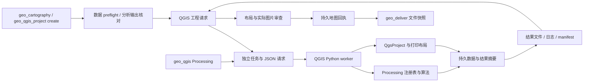

# GeoHarness 执行架构

主 Agent 运行在安装 GeoHarness 的 Python 环境中。现有 GeoPandas、matplotlib 与
可信 Python 分析执行入口保留；QGIS 通过独立安装的 Python 解释器运行，不向主进程
导入 PyQGIS、Qt 或它们的 native 库。没有 QGIS 时可以禁用集成，其他工具仍可运行。

## QGIS 数据流

`geo_cartography` 的默认 PNG/PDF 路径先复用已有数据解析与分类配色，将图层准备为
本地快照，再调用独立 QGIS 工程工具。主图、可选详图、图例和说明栏使用结构化布局，
工程保存后读回验证，图片从同一份打印布局导出。`cartography.static_renderer=matplotlib`
可显式保留旧静态渲染，HTML/SVG继续使用原有实现。QGIS路径不可用时返回实际错误。

新建图在预留成图/视觉预算前调用 `cartography/preflight.py`，核对实际字段、分类/分级、
数值类型、有限/有效几何、CRS、指定总数，以及主图/详图中的几何相交数量。
显式 GIS 范围为 xmin,ymin,xmax,ymax，必须声明显示 CRS；imshow 使用独立的范围顺序转换。
必需图层不满足可见数量时拒绝，optional 空图层/界外图层保留警告；栅格检查仅覆盖范围相交。
`geo_cartography` 可在数据副本中无损转换数值字符串，直接 QGIS 输入必须已有数值字段。

`qgis/discovery.py` 按配置或安装记录定位运行时，构造只包含系统必需变量和 QGIS
路径的子进程环境。`qgis/runner.py` 为每个调用创建唯一目录，持久化请求，启动
原生 Python 并等待结果。stdout/stderr 与 JSON 响应分开保存，native 日志不会破坏
协议。每个任务独立初始化 QGIS；当前没有跨任务的常驻进程或内存图层共享。

`qgis/worker.py` 只在子进程初始化 QgsApplication、字体与提供者，分派到
processing_worker 或 project_worker。主进程与 worker 交换文件路径和 JSON，
QGIS/Qt 对象不会跨进程传递。QGIS 模块的 API 依赖来自独立安装，不是 pip 依赖。

## Processing 执行

算法目录来自本机 registry，查询结果包含实际 ID、提供者和执行限制。help 返回
真实参数定义、默认值、枚举及输出定义；run 据此准备输入输出并校验参数，再调用
Processing。结果层必须持久化后才返回，摘要记录字段、数量、CRS 和范围。

本地 .model3 可复用多个已批准的内置算法；逐个检查模型子算法及参数来源。
脚本/表达式生成的文件路径、自定义提供者、数据库连接或自由命令参数不属于当前
支持范围。原有分析接口的距离和计数语义不因 QGIS 集成而改变；通用 Processing
调用按具体算法语义执行，使用者必须指定合适的分析 CRS 和单位。

## 分析事实与地图任务

`cartography/facts.py` 仅接受显式传入或由实际输出路径识别到的原生 geo_analysis 清单。
它读取实际 GeoJSON/CSV、核对清单输出 SHA256 和计数，检查 impact 标记与阈值/选集
一致性，并要求输出匹配当前实际地图图层。新清单使用 sha256_verified；没有原始摘要
的旧清单仅作 legacy_count_verified，不能升级为完整性证明。任意自由文字、
QGIS Processing 或 Python 清单不作为这个接口的统计证据。

`values.py` 在副本中规范日期/null 与分类值。内容比较使用已经核对的输出字节，经同一 GDAL/GeoPandas 读取后比较；只有能匹配原始 Feature.id 且属性里不存在业务 id 时，才排除驱动加入的编号。`derivation.py` 用原输出行位置、字段选择和新注记列生成地图视图，核验期从已验证字节重建该视图并与实际冻结图层比较，不把声明当作证据。来源记录同时保留完整分析数和上图数。

两个入口通过显式 `_source_bindings` 连接桥接副本与原始分析路径，直接 QGIS 请求不继承上下文中上一地图的事实。提供布局的 preflight 经独立 QGIS 的 `project_preflight` 测量字体、图例、比例尺与底栏，不导出图片/工程；底栏按实际字体和宽度换行并扩展高度。已保存工程仍按用户布局导出。

`retry_guard.py` 仅缓存明确的确定性校验失败，以参数、配置、读取范围和本地输入文件状态判断是否重复；关联分析输出与常见伴随文件也参与判断。失败期间输入变化、目录别名或 VRT 等无稳定身份的来源不缓存，暂时文件锁/超时不缓存。缓存使用可序列化对象，在真实用户输入时清理；它不替代内容摘要验证，也不增加回合/制图预算。

`provenance.py` 从上述输出核对结果生成 QGIS 说明栏，分别记录计量 CRS、导出 CRS
和地图显示 CRS；用户 footer_text 追加为备注。分析事实同时存入工程元数据及回执。
这条路径没有重新执行空间分析，不能证明数学、位置或业务语义正确。

`cartography/jobs.py` 为地图分配系统 UUID，在工作区 `cartography.jobs_dir` 下保存
index.json 与 `<UUID>/receipt.json`，默认目录为 `.geoharness/maps/`，配置目录必须位于
工作区内。别名、实际路径和图片摘要用于关联同一任务；工具通过 tracking.py 保存
已有产物及实际检查结果，缺少的检查保留 unverified。

`GeoQueryEngine.submit_message` 在每次真实用户输入时重置工作流预算并生成请求身份。
“继续/接着做/continue/resume”保留活动地图关联，没有活动关联时读取最近持久任务。
`continue_pending`、空回复恢复和内部重试不建立新用户请求、不重置预算。
当前请求的预算与持久任务 UUID 分开；切换历史 map_id 不会重新获得额度。
一次制图 Python 脚本只登记最后写出的 primary_map 候选为一个版本，map_candidates
列出全部图片候选；附件不解释为连续修订版。重审已登记旧图更新对应版本，不增加成图版本。

## 工程与交付

新 QGIS 路径通过 PyQGIS 创建、读取、保存真实工程，使用 QGIS 自己的布局导出器
生成预览和 PDF。保存图层 ID 与样式，将源数据复制为本地 GPKG/TIFF，并将外部
图片/符号资源复制进包。重新导出用户工程时写入新目录，保留输入工程。

`project.json` 的 backend=qgis、project_file、preview、preview_sha256 和 files
供 geo_deliver 打包；原有 matplotlib 工程格式继续兼容。交付验证预览摘要并复制
明确列出的包文件。QGIS PNG 与编辑工程来自同一布局；对已有 Python 图的 project
动作只打包实际图和图层，不保证生成的 QGIS 布局重现全部自定义注记。

回执分别保存 parameters、data_checked、rendered、layout_checked、visual_checked、
packaged、delivered 的实际报告和文件摘要。quality_status=passed 要求同图的数据合同、
实际渲染、已测布局及实际视觉审查全为 passed；其余为 draft。质量范围限定为
map_data_contract、layout_geometry、visual_image，analysis_correctness 固定为 unverified。
像素计数、工具执行成功、工程打包或模型文字不能补齐缺失阶段。

QGIS bounds_check 测量结构化模板中的分区、元素边界、图例/文字溢出；非结构化模板
可能 checked=false。它没有遍历证明所有地图标签或语义；PNG 仍须实际视觉审查。
Python `.layout.json` 也只证明报告内已测几何项，单独审图不能补造数据 preflight。

`geo_cartography(action="status")` 读取已有回执并重新计算图片、工程及交付文件摘要，
不创建任务。图片或工程改变时对应证据为 stale，质量不能沿用。geo_deliver 还核对
工程与登记快照一致以及实际复制结果，变化时交付为 draft；交付保存完整
map-receipt.json。该证据链没有实现自动修改差异比较、回退或质量准确率评测。

## 隔离与取消

QGIS create 使用临时 GPKG/GeoTIFF 冻结输入，预检和 worker 共用这一副本。
原始定位符用于核对分析事实，已加载 GDF 还必须与已验证输出的完整属性/几何内容一致。
原始文件及已发现附属文件在冻结/事实读取前后核对摘要；不宣称源 GIS 文件有操作系统级并发事务。
取消冻结或交付时等待线程关闭，连续取消也不能留下后台写入后再开始下一请求。

输入只从工作区、配置的数据目录和产物目录读取；输出只能写入本次唯一任务目录。
配置、凭证、远程 URI 和源文件覆盖均受接口约束。VRT 等支持格式的依赖也检查路径。
子进程不继承主 Agent 凭证和个人 QGIS 配置，使用独立 profile。

Windows worker 启动 native 代码前附加 Job Object；取消/超时清理整个任务进程树。
其他平台使用独立进程组。这里的路径与算法检查用于可信 GIS 工作流，不是可抵御
任意恶意 native 代码的操作系统沙箱。
