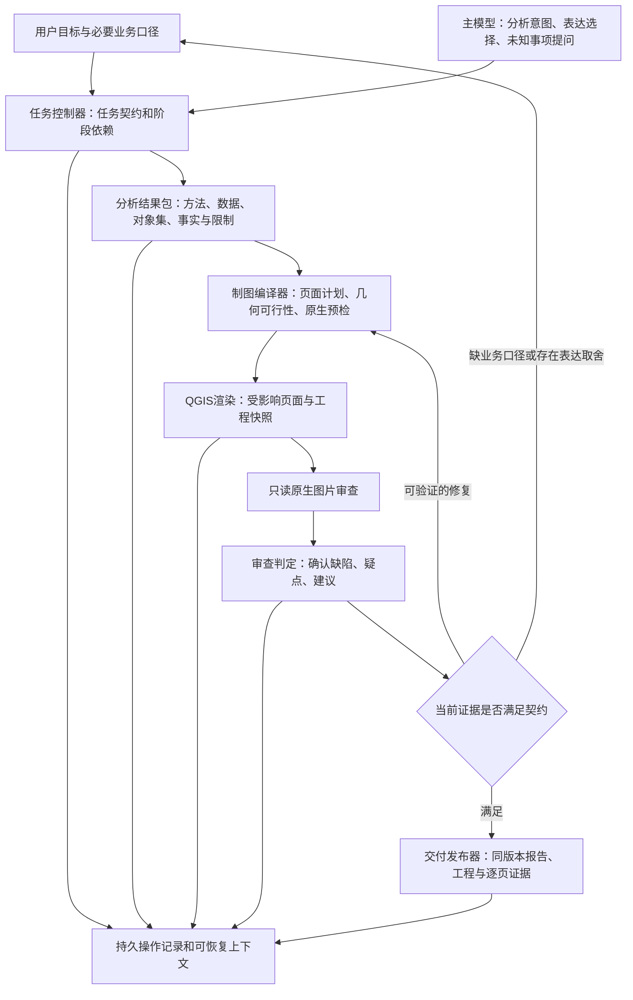

# GeoHarness 系统执行重构方案与实施状态

日期：2026-10-19。用户已授权实施，且明确标准分析以 QGIS Processing 为主，
`geo_python(backend="qgis")` 提供独立的 PyQGIS 控制台扩展。本文保留完整目标；
已经落地的接口与边界以 `user-guide.md` 和下列实施证据为准，不把设计目标当作完成事实。

已实施：持久任务与依赖执行、执行前请求/执行后完整证据、失败指纹与恢复互斥；
统一分析结果包及各候选图层绑定；只读图片审查的稳定契约和持久像素结论；
圆形点符号的保守纸面冲突检查；系统创建工程的页面 PNG 增量复用；交付事实复算。
恢复时保存并复核已测量输入别名；节点绑定相关配置和实现摘要，未完成的视觉检查
不作为成功依赖复用。分类符号的原生测量遵守 startRender/stopRender 生命周期。
同坐标记录保留风险提示，由真实业务含义决定是否聚合；不擅自移动真实坐标。

已做真实本机 QGIS 验证：Processing 控制台到结果包；原始输入写保护；
三页地图改名单表题仅重画名单，复用页像素相同，共享样式变化使缓存失效；
受管理 Processing→结果包→工程→草稿交付整链，第二次执行不重跑节点。
合成验证不代表真实业务视觉通过或全对话性能达标。

仍须验收：真实主模型/high 与图片模型业务对照运行、p50/p95；有效独立代码审查。
完整问题处置状态机、所有原生符号/最终文字边界的精确冲突检测，仍属于后续能力，
当前仅保留未解决疑点并报告 `needs_recheck`，不将未再次报出的问题自动宣布修好。
最终工程验证与安装证据见 `diagnostics/2026-10-19-system-rebuild-validation.md`。

## 目标与完成定义

从“模型自由串联底层工具”改为“模型提出任务和必要决策，系统执行有契约、有依赖、有恢复能力的工作流”。解决问题的标准是固定真实样例中的重复行为被消除、事实错误被挡住、未解决事项如实暴露，并完成真实运行验证。

保留OpenHarness依赖及TUI、QGIS原生工程与图片、自由Python扩展、自定义图片模型、中文默认输出、现有high思考设置与用户配置。20分钟是性能期望，不是超时预算或调用次数上限。

已有SQLite地图台账、输入引用、冻结快照、Pydantic模型、Python阶段依赖、QGIS预检与渲染继续复用。不重写QGIS本身，不同时维护两套判定质量的流程。

当前证据见 `diagnostics/2026-10-19-latest-test-review.md`：21次制图尝试、17个成功版本、29页审查、0缓存命中、全部进展未建立，以及正式分析证据为空和报告事实错误。

## 核心架构与责任

五个对外职责：任务控制、分析结果、制图编译、审查判定、交付发布。内部辅助函数服从这些职责；不新增一层仅透传参数的工具链。唯一进展判据归任务控制器，唯一地图版本事实归现有地图台账，唯一统计事实归其分析生产者。

## 1. 任务控制器成为执行入口

### 任务契约

记录输入版本、用户目标、分析方法与业务口径、对象选择谓词、实体主键、度量单位、输出要求、页面职责与验收规则。分析CRS、显示CRS、存储CRS分开。业务缺失事项形成可恢复的待回答状态；字体、边距等常规工程选择由系统完成。

新计划revision仅在目标、数据、方法、对象集或页面职责真实变化时建立。模型改写描述、换运行目录、生成新PNG不构成计划变化或进展。

### 阶段状态

内部阶段至少区分pending、ready、running、succeeded、failed、stale、interrupted、needs_decision；执行完成、证据登记、技术校验、视觉评估、分析方法确认各自保存。不能把一次工具is_error=false映射成任务进展。

主路径为：确认必要口径→分析→验证结果包→编译页面计划→原生预检→渲染→逐页审查→判定与定向修复→最终发布。只有依赖当前、前置条件满足的节点可以运行。用户可以预览分析未验证的草稿，但它不能越过正式发布校验。

### 工具界面

扩展已有geo_task提供计划提交、执行、恢复、状态、证据读取等任务级动作，保留既有评分动作。具体新参数名在实施时落成Pydantic模型，本文不将它们冒充现有API。

正常路径中，模型提交分析意图、结果引用、页面目标和明确修复意图，系统自动串联确定性节点。完整geo_python和geo_qgis_project保留兼容入口；在受管理任务中也必须经过相同状态检查和登记，不能作为绕过验收的第二条正式交付路径。

按阶段向主模型提供必要的短工具schema与准确的按需帮助。registry仍保留兼容调用，工具可见性变化必须覆盖旧历史调用回放。提示词和帮助默认中文。

## 2. 分析结果包：让事实校验成为必经路径

统一发布结构化分析结果包，复用现有manifest、实体引用和write_analysis_report。结果包包含：

- 输入及输出摘要、实际schema、实体主键与版本；
- 可复现操作、参数、计算单位、计算时观测到的CRS及转换；
- 全集和子集各自独立的selection_id、筛选谓词与成员摘要；
- 统计项的字段、单位、聚合方式、分母、过滤条件、结果及证据引用；
- 方法/业务口径的确认状态、未知事项及适用限制。

例如“全体人口已知数”和“重点对象人口已知数”是两个不同事实，分别绑定234与22的选集。事实不能脱离选集引用，仅传一个8让模型自行解释。

### 标准操作与扩展代码

距离、覆盖、分级、汇总、栅格采样、分类频数、连接及名单生成先复用现有原生操作和助手，补齐缺少的可组合操作。方法由任务决定，不写死火灾、500m或某EPSG。

任意Python仍可探索与扩展，但其输出首先是candidate。只有输入、输出、字段、实体、单位、谓词和可复算统计验证成功，才可发布为下游可信输入。已知标准算法的执行证据可以核验；任意自定义数学逻辑不能仅靠文件哈希认证科学正确性，必须保留method_unverified并请求实际需要的确认。

对距离/面积等支持的计算入口记录运行时方法和CRS；不能再从模型填写的method字符串推断metric_crs。自定义numpy表达式等未被观测的计算明确记unknown。

为栅格分别声明continuous/categorical语义：整数masked栅格经受控浮点转换处理NaN；类别编码默认统计频数，只有有依据的映射才参与数值聚合。距离、边界距离、面内距离0及覆盖关系明确区分。

### 文字与论断

正式表格、数字摘要、图例计数、页脚事实、报告数量和最终答复事实段由同一结果包生成。解释性文字单列，附支持引用和限制。定量及时间论断必须绑定对应事实；概率论断需要概率模型或明确来源，静态面外距离不能支持“某时次极可能被覆盖”。

校验能确保来源、选集、数值、单位和已声明论断类型一致，不能证明任意自由文字的全部推理；因此正式报告不再接受无约束自由拼接作为已验证结论。纯制图任务可将分析标为not_applicable，不强迫无关计算。

## 3. 制图编译器：先证明可画，再调用渲染

模型提供目标，编译器生成完整QGIS参数。保留已有spec_ref/plan_ref，统一成可追溯编译输入与输出，不让主模型反复复制完整图层样式。

### 先确定对象集和页面职责

主图负责全域关系，详图负责具体密集对象，名单负责完整名称和属性。各页有稳定page_id、实际对象集、必需/可选图层、编号责任与共享约束；page_index只用于打印排序。

详图从需要解决的问题所对应的真实要素集合选择，不能从最小近邻种子推断目标，也不能用移动后的标签锚点代替真实对象计算覆盖。标题、可见编号说明、名单选择和局部图例均从实际页面选集生成。总览与详图职责必须共同覆盖用户要求，不能通过改用途文字来豁免真实缺陷。

### 原生测量与约束

以mm和实际加载字体测量：地图框、符号占位、最终文字矩形、锚点及引线、图例、比例尺、标题、表格行列。包括：

- 符号距离小于半径和时，提前报告当前比例尺下不可行；
- 注记矩形重叠、与符号/必要线状要素压盖；
- 引线长度、穿越其他标签/符号、交叉和稳定回指；
- 标题与注释换行、表头完整性、长名称换行及名单跨页；
- 主体覆盖、分类值、图例类别与局部页面可见内容；
- 总览和详图共享编号、跨页成员完整性。

读取实际QGIS渲染标签位置的能力必须先在本机版本做原生探针；若不能取得所需信息，使用系统控制的显式注记及测量，标注检查范围，不能把估算占位声称为最终标签边界。

### 有限的布局策略

按具体约束选择：原位编号→受限偏移与短引线→目标详图→分区/分幅。表格选择按可读字号与实际内容适配纸面或分页，不默认要求填满整页。

这是针对问题类别的候选策略集合，不是固定轮数预算。对同一输入与目标，候选有确定指纹；同一候选不重复执行。数据对象不能为排版方便而被删除、错误聚合或移动真实坐标。符号聚合只有在任务契约允许且明示含义时采用。

## 4. 增量构建：页面依赖与工程完整性分开

计算节点包含分析、共享样式、页面内容、页面像素、审查和最终工程包。内容指纹使用输入摘要、有效参数、字体/渲染环境和依赖，不包含时间戳、临时路径和新版本号。

名单列宽修改只使名单页失效；主图无效范围不因新名单而扩大。详图标题修改只影响该页及最终工程；跨页编号或共享样式变化按依赖使所有相关页失效。

未变页面复用原始像素及有效结论，再绑定当前工程包；工程整体的一致性与文件摘要仍重新验证。无法证明依赖完整的操作保守重建，禁止复用未知有效性的页面。

QGIS工程的保存与页面导出分开：更新最终工程不必重导出全部未变PNG。实施原生对照实验验证字体、布局、渲染上下文变化的传播范围。冷启动优化和常驻QGIS worker仅在剖析证明收益后考虑，不作为首要解法；同一工程的QGIS/Qt变更串行，不能直接并行操作原生对象。

最终PDF与复用PNG必须来自同一页面内容和渲染契约；通过工程读回及必要的最终页面比对验证，不能拿旧PNG的审查结果证明内容未知的新PDF合格。无法证明同源时，仅重渲染/核查受影响页。

## 5. 原生图片审查与判定分离

geo_map_review维持只读，只收图片、稳定检查要求及必要页面用途，返回可见问题；不生成修复参数、不修改工程，不承载完整分析表或业务推断。

### 三个独立身份

1. ImageIdentity：规范化像素、尺寸、方向和颜色处理规范。
2. ReviewContract：稳定页面角色、检查项、要求版本、实际裁切/缩放规范、审查模型与输出协议版本。
3. PackageBinding：本次map/version/page与文件摘要和来源绑定。

缓存键由前两者计算，第三者只决定结论能绑定哪个当前包。用户实质改变检查要求、图像处理、模型配置或页面角色才失效；普通task改写、新运行目录、新版本号、同页打印索引变化不应失效。任务契约不能由模型任意改写以寻求通过。

只缓存已经完整完成、协议有效的图片结论；timeout/unverified/不完整响应不作为成功证据。命中issues也复用，不能反复抽样直到passed。保留源审查证据与当前绑定，原始报告不可覆盖。

### 原始发现和修复决定分开

原始发现归为可确认缺陷、待核实疑点、风格建议。缺陷是否阻止交付取决于冻结的验收要求与证据；正常留白不能单独成为失败原因。有明确用户排版要求时则检查对应要求。

确定性检查负责数据、范围、几何和成员；图片检查负责实际像素。几何检查通过不能反证图片一定清楚。遇到疑点先核对同一原图局部、对象/布局证据；确有必要时只复核存在争议的裁切区域和具体检查项，不能重审所有未变页。

“误报已排除”必须保留处置依据，不篡改原始warning或自动把未解决问题标passed。争议无法判定且影响验收时进入needs_decision；服务失败保持unverified，并走服务恢复而非改图。

## 6. 问题生命周期与收敛控制

问题身份以检查规则、稳定page_id/frame_id、可信对象候选集合和原图坐标位置建立，不要求自然语言位置完全相同。bbox统一转换到原始页坐标，保留ROI映射；标签锚点移动与页面尺寸变化使用实际变换关系，不直接比较不同ROI的归一化数。

无法可靠关联对象时明确记录unknown，不能猜feature_id。新描述没有匹配旧问题时，旧问题仍待复核，不能计作已解决。

每个修复提案必须包含：针对的问题、根因假设、变更范围、预期改善指标、可能回退的约束、候选指纹。修复后以原问题和全局约束核对；改善不能靠删除要求、缩小对象集、隐藏要素或提高未核实结论获得。

示例：9/11符号重叠，应解决占位冲突或增加负责该对对象的详图；不能连续增大两个圆点，再以新PNG算进展。

仅新确认事实、已核实缺陷改善、必要依赖完成或用户明确决策算进展；新路径、新文件、模型换措辞不算。无信息增益候选直接返回已有结果。当前策略无法解决时选尚未尝试且适用的策略；涉及纸张/页数/表达要求的实质取舍则带证据提问。所有适用候选均不可行时明确原因和选择，不无限继续，也不假装通过。

## 7. Python、日志和上下文使用同一执行协议

业务输入引用和只读运行证据引用分开。提供按operation_id分页读取stdout/stderr/manifest/事实的正式入口；不再为打印上一步结果启动Python，不通过任意文件白名单放开读取。

Python执行返回短结构：阶段、成功/失败、确切错误代码、简要原因、有效输出、证据引用、恢复动作。完整代码、输出、错误和依赖在返回前存档。TUI继续使用小×与折叠行数展示；模型仍拿到足够的结构化错误，不因UI简洁而丢失原因。

在子进程之前做语法、已知字段要求、输入类型与已声明输出检查。任意Python无法静态杜绝全部NameError/KeyError；运行时校验失败只影响当前节点，正确上游复用。标准操作尽量消除重复的临时代码。

模型上下文主要由当前任务快照、已验证引用、未解决问题、下一步允许动作和近期必要对话组成。先持久化完整工具结果，再返回给OpenHarness，避免依赖“请求之前才归档”的时序。上游即使清空旧消息，依然可以通过证据引用恢复。工具schema按阶段投影，不能靠压缩掉参数含义提高表面速度。

## 8. 持久执行与恢复

沿用现有地图SQLite管理地图版本、页面与报告；任务状态和操作日志有单独且唯一的持久所有者，通过引用关联，不再以metadata里最后一条记录作为权威状态。实施时优先复用既有任务存储入口，缺少的操作日志用任务级SQLite表实现，不复制地图、报告和统计正文。

操作在启动前记录running、输入指纹和父依赖；结果和完整日志先落盘，校验后提交状态及引用，再展示完成。任务结束、异常、用户取消和进程恢复均产生可追踪状态。

文件与SQLite不是天然跨介质原子事务：采用prepared→校验文件→committed，恢复时核对摘要，孤立文件保留但不晋升成功产物。针对同一任务版本使用并发租约/条件提交，防止两个构建互相覆盖。

外部模型调用在进程崩溃窗口不能假设exactly-once。请求已发但结果未持久化时记unknown，优先查回可用结果，不盲目立即重发；本地可确认完成的计算、渲染和审查不重复执行。

## 9. 交付发布器是唯一正式验收入口

最终以同一冻结输入、分析包、页面计划和工程版本聚合：数据/方法状态、布局状态、逐页视觉状态、未解决问题、包完整性和交付状态。所有数字与对象成员再次从落盘结果核对，检查引用是否stale。

报告、PNG/PDF、QGIS工程、名单和summary引用相同选集及版本。报告若早于最后一次事实变更，应失效重生成。存在未验证方法、服务未完成或关键缺陷时保留真实状态；用户明确选择草稿可交付草稿，不自动宣布合格。

## 10. 实施边界和迁移路线

| 顺序 | 核心工作 | 主要落点 | 阶段必须通过的验证 |
| --- | --- | --- | --- |
| 0 | 冻结本轮输入、日志、图片及预期事实，建立真实回归夹具 | diagnostics、tests中的受控fixture | 复现同像素漂移、错误人口范围和重复候选，无付费调用 |
| 1 | 建任务控制器、持久操作、统一结果协议；入口适配 | engine、task_state、performance、session_state、geo_task | 中断恢复、不重复完成节点；直接旧工具也经过约束 |
| 2 | 发布分析包、选集事实、标准操作与报告生成；可信产物发布 | execution、analysis、data、cartography/facts | 全体142/92与重点8/14隔离；无概率证据不能生成概率结论 |
| 3 | 页面编译、真实点集与布局约束；原生标签能力探针 | qgis/specification、project_worker、layout_table、cartography/layout_plan | 160m/5.4mm冲突首轮发现；正确目标详图、完整标题/表格 |
| 4 | 页面增量与三身份审图缓存、问题处置/收敛 | qgis导出、workflow、pixel_review、review_progress、jobs | 相同内容相同要求0新增视觉请求；只失效依赖页；无证据不消除旧问题 |
| 5 | 主模型上下文、证据读取、最终发布与兼容清理 | runtime、api_client、model_context、geo_map_review、geo_deliver、TUI | 上游清空历史仍可恢复；默认流程不再生成show_stdout脚本 |
| 6 | 打包、实际安装、同一业务全链路与故障验收 | CLI、wheel、文档与诊断 | 源码/wheel/实际CLI一致；真实逐页质量与事实通过再宣布完成 |

这是一个整合版本，内部逐阶段验证，不分散发布多套临时补丁。开发期间用内部开关隔离旧入口；新流程验收后成为默认，旧公开工具作为适配器保留，不同时运行旧自动修复循环。

配置继续由 `C:/Users/Administrator/.geoharness/config.yaml` 管理。新配置键实施后才写入示例和用户文档，默认兼容现有配置，不修改主模型/high、自定义图片模型及凭证。不修改AGENTS、Skills、上游依赖、原业务数据或旧地图。

## 11. 验收矩阵与性能标准

| 场景 | 必须观察到的行为 |
| --- | --- |
| 相同名单图、task换措辞、同一检查契约 | 复用同一结论；不会再抽样得到另一个质量结论 |
| 新增详图使名单从第2页变第3页 | page_id稳定，像素检查复用；当前包绑定重新验证 |
| 相同像素已报issues | 复用issues，先核实/修复；不重试到passed |
| 源数据、字体、样式、真实要求、裁切或模型变化 | 精确失效相应页面/检查，不错误沿用旧通过 |
| 名单留白、字体已经可读 | 不仅因留白而失败；不放大字号导致无意义分页 |
| 实际裁切、比例尺文字缺失、局部图例多项 | 明确定位并阻止相应验收；不能以几何检查通过覆盖像素问题 |
| 9/11近邻与北部点群 | 占位冲突提前发现；详图覆盖正确真实对象，标题/图例自动同步 |
| 同一问题换描述/ROI或移动锚点 | 保持未解决身份或明确待关联，不能自动计作解决 |
| 全体与重点人口统计 | 142/92、8/14及806各自绑定正确选集 |
| 普通Python绕过报告助手 | 可保留探索成果，不能无依据发布verified分析及正式结论 |
| 网络超时 | 状态unverified，走服务恢复；不重新分析/改图 |
| 子进程、登记、保存中断 | 已完成证据可恢复，部分产物不晋升成功，无故障后全任务重跑 |
| 旧大台账、旧工程和旧工具调用 | 原有受控迁移与读取兼容，旧成果保留 |

验证采用三层：保存日志/图片的离线回放与故障注入；真实QGIS原生生成与工程读回；真实主模型及图片模型运行。离线层使用故意返回相反结论的假服务验证缓存/状态机制，不代表真实视觉质量通过。

真实运行除本次234点/22重点样例，还应覆盖稀疏单页和密集多页，防止写死业务数据。逐页核对技术、视觉和事实；取得有效的独立审查，不能把代理确认语计作完成。

性能目标是减少必要模型往返、重复渲染、重复视觉请求及上下文字符。普通同类任务争取首版形成合理页面分工，通常1次成图加必要的有依据修复；这不是1次或3次硬限额。

在同机、同输入、同主模型/high、同图片配置下记录总耗时、关键路径、各阶段/model/工具耗时、tokens、缓存、失败和每次返工原因。多次对照报告样本数与p50/p95；样本不足不宣称稳定达标。20分钟作为效率目标测量，不能用提前终止或降低质量达成。未达到时根据实测关键路径继续优化，不能仅以单测通过结项。

## 开源方案评估记录

已核查GitHub的LangGraph与Pydantic项目状态和许可证，原始公开源分别为 `https://github.com/langchain-ai/langgraph` 与 `https://github.com/pydantic/pydantic`。本轮不新增依赖、不执行外部代码。

选择复用现有Pydantic、asyncio和SQLite实现本地任务控制：GeoHarness已具备运行引擎、阶段记录和地图台账，另加完整代理编排框架会引入第二套会话、恢复和工具状态。是否未来更换引擎，应由适配器成本和真实恢复验证决定，不能期望更换框架自动解决业务事实和地图约束。

## 完成判定

本设计的交付承诺是逐条实现上述机制，并用真实业务和失败场景证明已知问题不再复发。复杂自定义分析和外部模型服务的未知情况必须进入明确的未知/待决策状态；不能承诺任意未来任务绝对零错误，更不能把未知错误包装成成功。

只有同一安装版本的事实、页面、审查、恢复和真实性能验收完成，才宣布系统修复完成。
